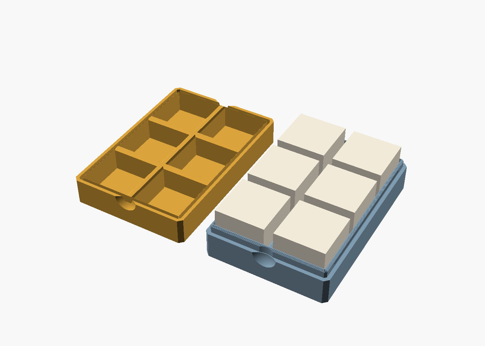
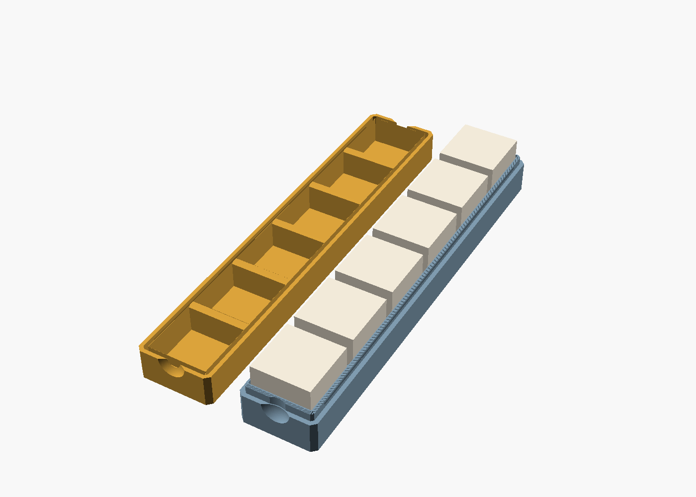
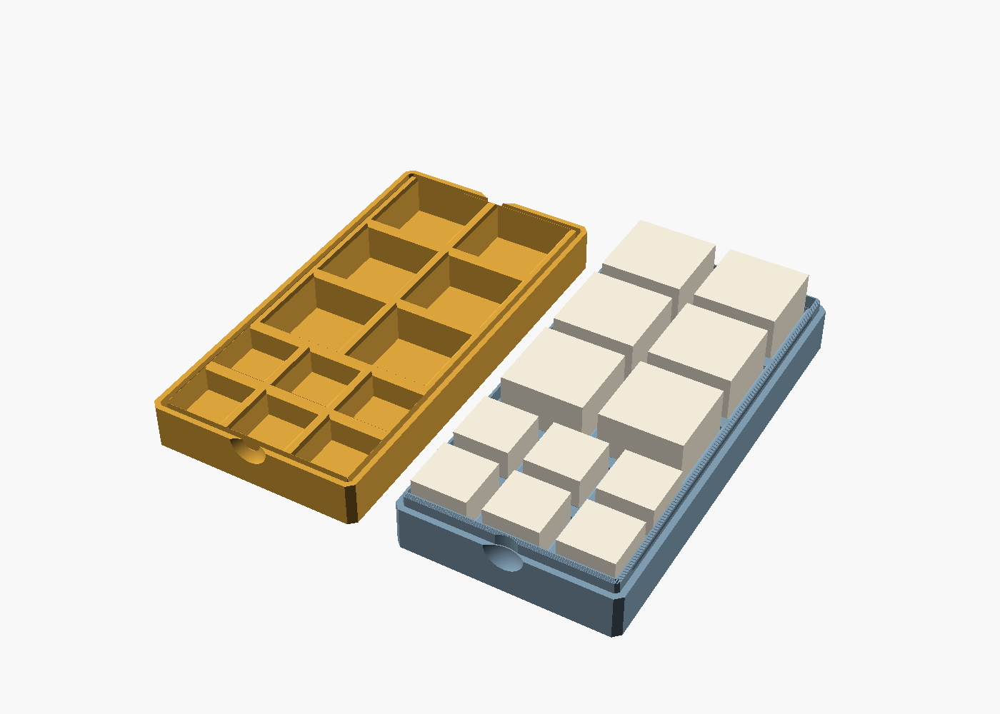
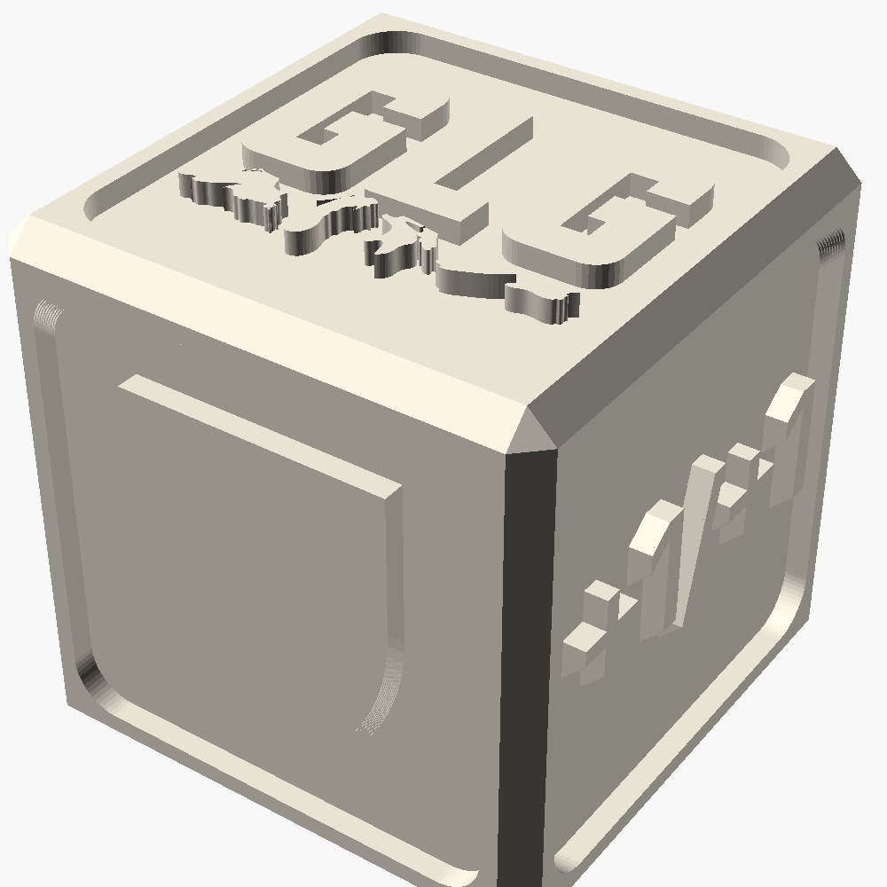

# dicecase

a snap-shut clamshell dice case, in three variants. two separate halves split at the dice
midline, shut with no magnets and no hardware: the bottom has a rim that clicks into a
rebate in the top, with a bead along both long sides. thumb dishes on the two ends get it
open.

the variants answer "what are you carrying?", the same question deckblock's do. everything
else, the rim, the bead, the thumb dishes and the depth budget, is shared, so a fix to one
is a fix to all three.

| variant | holds | case, closed | bottom | top |
|---|---|---|---|---|
| `grid` | 6 x 24 mm d6, two across | 59.6 x 88.0 x 26.7 mm | 26.1 cm³ | 23.1 cm³ |
| `row` | 6 x 24 mm d6, in a line | 31.2 x 173.2 x 26.7 mm | 28.8 cm³ | 24.5 cm³ |
| `mixed` | 6 x 24 mm + 6 x 16 mm d6 | 64.0 x 128.8 x 26.7 mm | 52.6 cm³ | 48.5 cm³ |

the models are named so they sort into the order you print them:
`Dicecase_<Variant>_1-bottom` and `Dicecase_<Variant>_2-top`, in `stl/` and `3mf/`. pick a
variant in the openscad customizer with `variant`, or edit `custom_bands` for your own.

## grid



six 24 mm dice, three rows of two. the pocket-friendly one: 59.6 x 88 mm is about a deck
of cards. the sixth pocket is where the [counter die](#the-counter-die) goes.

## row



the same six dice in a single line, 31.2 mm wide, for a pencil-case slot or a long pocket.
at 173 mm it wants a 180 mm+ bed. on an a1 mini, lay it on the diagonal.

## mixed



the six 24 mm dice, plus six 16 mm deckblock-size dice in two rows of three under them.

every die sits half in each shell, centred on the parting plane, so a pocket is half its
own die deep. a 16 mm die in a case sized for 24 mm ones just gets an 8.15 mm pocket
and a thicker floor under it, and it still registers the halves like the big ones do.
`d6(size)` takes any size, so another mix is a new band list.

the small dice stand 8 mm proud when the case is open, against 12 mm for the big ones,
which is still plenty to grab. the thick floor under them is most of why `mixed` weighs
twice what `grid` does. 15% infill takes care of it.

## the depth budget

```
  1.2   floor
 12.15  pocket       <- half the die, plus half the 0.3 headroom
 ------
 13.35  one half  x2 = 26.7 mm closed
```

the dice are a second register. each one sits half in the bottom and half in the top,
so once its shut the halves cant shear past each other. open, every die stands 12 mm
proud of the bottom. thats why deckblock's push-out holes and pinch notches are gone,
because nothing ever needs pushing out. the 0.8 mm lead-in at each pocket mouth now does
real work: its what steers the exposed half of each die into the top as you close it.

## the click

```
  top     |skin|  rebate  |
          | 1.6| <-------> |      groove: 45 deg diamond, 0.35 deep
          |    |   rim    |
  bottom  |    |>| 1.2 |  |      bead:   45 deg diamond, 0.30 proud
          '----'-'-----'--'
             0.15 gap
```

the same rule as deckblock's detent, learned the same way: the bead only does
anything once it beats the slop. `bead_h` (0.30) has to exceed `rim_c` (0.15), and
what's left over, 0.15 mm, is the interference. over a 4 mm tall, 1.2 mm thick rim
thats about 1.7% strain at the root, which is inside PLA's elastic range, so it clicks
rather than cracks or wears out.

both faces of the bead and both faces of the groove are 45°, so it prints without
support. its also symmetric, so it takes the same force to close as to open. the bead
stops 6 mm short of every corner because the rim cant flex there.

the wall went from 2.5 to 3.2 mm to hold a 1.6 mm skin outside the rim.

| symptom | change |
|---|---|
| no click / falls open | raise `bead_h` (0.30), ±0.05 at a time |
| too hard to open | lower `bead_h` |
| rim wont go in at all | raise `rim_c` (0.15) |

## why theres no hinge

there was one: five printed knuckles on a 1.75 mm filament pin. it was dropped after a
test print, where the pin clearance didnt work. a 2.05 mm bore printed horizontally
comes out undersized, and one bore through every knuckle means the same friction that
holds the pin also stops it turning. the two-piece needs neither, and the dice register
the halves anyway.

## measured

`tools/build_all.sh` builds all six parts, three variants x two halves, and checks them.

- mesh: every part closed and manifold, genus 0. zero-area facets are stripped, same
  as deckblock.
- overhang: 0.00 mm² unsupported on every part.
- interference: the closed halves intersect for 0.000 mm³ on all three variants.

`render.sh` runs that, then renders `images/` and fails if any image comes out blank.
each half is wrapped in `render()` in the previews, the same fix deckblock needed:
without it the preview's csg normaliser gives up on the rim and draws nothing.

## not printed yet

none of this has been printed. whats new and unproven:

- the click. `bead_h` is a calculated value, not a felt one. print a bottom and top
  and adjust in 0.05 steps.
- `die_size = 24.0` is nominal. caliper your dice.
- the thumb dishes bite 2.0 mm, not 2.5. with six dice every edge has a pocket right
  behind the wall, and 2.5 into the 3.2 wall left 0.7 mm at the bottom of the dish.

## print

both halves flat, outer face down, parting face up, exactly as oriented. no supports.
0.20 mm layers, 3 walls, 15% infill. petg will be more forgiving of the click than pla.

## files

| file | what |
|---|---|
| `dicecase.scad` | parametric source: `variant`, `part` |
| `preview.scad` | preview renders only |
| `render.sh` | runs `tools/build_all.sh`, then renders `images/` |
| `stl/` | `Dicecase_<Variant>_{1-bottom,2-top}.stl`, numbered in print order |
| `3mf/` | the same parts |
| `images/` | `<n>-<Variant>-{open,closed}.png` |
| `tools/` | meshcheck, overhang and volume (from deckblock), build_all with the closed-fit check, lamp and components for the die |
| `counter-die/` | the counter die, see its readme |

## the counter die

[`counter-die/`](counter-die/) is a 24 mm d6 for the sixth pocket of `grid` (or any 24 mm pocket): counter symbols
(+1/+1, −1/−1, poison, shield, energy) and the glg logo instead of pips. three versions,
one per way you colour it: a one-colour cameo that reads by shadow, an engraved die for
the ams or paint, and a 3-part shell-and-core that prints two colours with no purge.



built on what [deckblock](https://github.com/skyphose/deckblock) learned: the band layout
model, the 0.4 mm/side die clearance, the detent rule, the mesh tools and the
`render()` fix for blank previews all come from there.

CC BY-NC-SA 4.0, same as deckblock.
