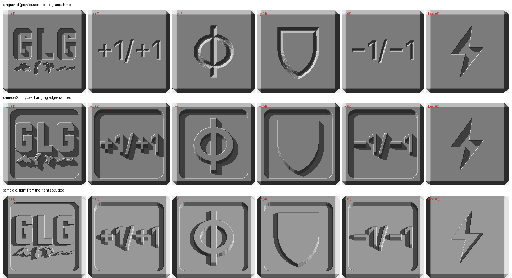
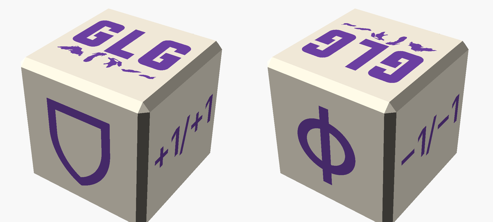
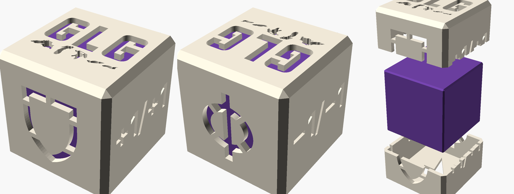

# counter die

a 24 mm d6 with counter symbols instead of pips, and the glg logo on one face. made to
fill the sixth pocket of the dicecase, which takes any 24 mm die.

| face | opposite |
|---|---|
| glg logo (printed up) | lightning bolt, a generic energy mark (on the bed) |
| +1/+1 | −1/−1 |
| poison, a Φ | shield |

every face is one line in `faces` at the top of each scad. kinds are `logo`, `text` (any
string, set in barlow semi condensed), `poison`, `shield`, `bolt` and `blank`, so a stun,
lore or oil face is a one-line change.

three versions, one per way you colour it:

| version | colour | parts | source |
|---|---|---|---|
| **mono** | one filament, no paint | 1 | `counter_die_mono.scad` |
| inlay | ams, or paint | body + inlay | `counter_die.scad` |
| 3-part | two filaments, zero purge | 2 shells + core | `counter_die_3part.scad` |

all of them print logo up with no supports, and all are untested.

## mono: readable in one colour

every face is a cameo, like a coin or a wax seal: a panel sunk 1 mm into the face, with
the symbol standing back up to the full surface inside it. the pocket wall throws a
shadow round every symbol, and the symbol's top is the only flat area at face level, so
it catches the light differently from the floor around it.

openscads preview cant judge this, because it draws no shadows. the symbol tops and the
pocket floor face the same way, so they shade the same, which hides the whole effect.
`tools/lamp.py` ray-casts each face off the stl and lights it from a low angle with real
cast shadows, like a desk lamp. the top row is the engraved inlay die in one colour. the
next two are the cameo lit from two sides.

the first cameo ramped every edge at 45°, which fattened each stroke by 1 mm a side
on the way down and merged the +1/+1 into a blob. on a vertical face only two edges
actually overhang in print: the top edge of the pocket, and the bottom edge of each
raised stroke. so now only those two are ramped, in 0.1 mm terraces, and the strokes
keep their true width. the shield is a solid silhouette, because in one colour an
outline cameo is a thin ridge and reads as a doodle.

the bolt on the bed face stays a plain engraving, because a sunk panel on the bed would
bridge the whole face. its floor, 41 mm² at 0.8 mm up and about 3 mm across, is the
only real bridge. the overhang check also counts about 124 mm² of 0.1 mm terrace treads
on the side faces, which print as 45° slopes.

## inlay: ams or paint

symbols engraved 0.8 mm. the side faces are V-engraved: the surface outline is exactly
the symbol and the walls step in at 45°, so no stroke edge bridges.

- **ams / mmu:** load `counter_die_body` and `counter_die_inlay` as ONE object with two
  parts. the inlay is 21 separate pieces by design, one per letter, lake and stroke, and
  each sits in its recess. it doesnt overlap the body, checked by intersection.
- **paint:** print the body, wipe acrylic into the symbols, scrape the faces clean.

the catch with the ams is purge. the symbols sit on all six faces, so the swap happens
on almost every layer from about 5 mm up, which is well over a hundred swaps. the purge
can easily weigh more than the 16 g die. that's what the next version is for.

## 3-part: two colours, zero purge

| part | colour | what |
|---|---|---|
| `shell_bottom`, `shell_top` | die colour | the outer skin, 1.2 mm, split at the midline like the dicecase, every symbol cut clean through as a window |
| `core` | accent colour | a plain cube that fills the shell and shows through every window |

drop the core in the bottom shell, put the top on, run a thin line of ca round the seam.
the core registers the halves (0.15 mm a side, `core_c`). print the bottom shell bolt
face down and the top logo face down, as exported, and the core any way up at 10-15%
infill, since it's only seen through the windows.

**stencil ties.** a window cut clean through the shell leaves any shell a symbol encloses
as a loose piece: the middle of the shield, and the halves inside the Φ. those two carry
small ties, the way a spray-paint stencil does. `tools/components.py` checks every part
comes out as one piece, and all three do. the shells have a few short bridges where a
window edge spans open air, the longest about 4.4 mm across the top of the shield.

## measured

| | volume | pieces | mesh |
|---|---|---|---|
| `counter_die_mono` | 12.0 cm³ | 1 | closed, manifold |
| `counter_die_body` | 13.4 cm³ | 1 | closed, manifold |
| `counter_die_inlay` | 0.2 cm³ | 21 (by design) | closed, manifold |
| `counter_die_shell_bottom` | 1.6 cm³ | 1 | closed, manifold |
| `counter_die_shell_top` | 1.5 cm³ | 1 | closed, manifold |
| `counter_die_core` | 9.6 cm³ | 1 | closed, manifold |

## files

| file | what |
|---|---|
| `counter_die_mono.scad`, `counter_die.scad`, `counter_die_3part.scad` | the three sources |
| `glg_logo.svg` | the glg logo, same as glg-nametag |
| `fonts/` | barlow semi condensed semibold, under the ofl |
| `stl/`, `3mf/` | every part |
| `images/` | the renders and the lamp test |
| `../tools/lamp.py` | lights each face with cast shadows, to judge one-colour readability |
| `../tools/components.py` | counts connected pieces in an stl |

the glg logo and the font are not covered by this repo's CC BY-NC-SA licence. see
`../LICENSE.txt`.
